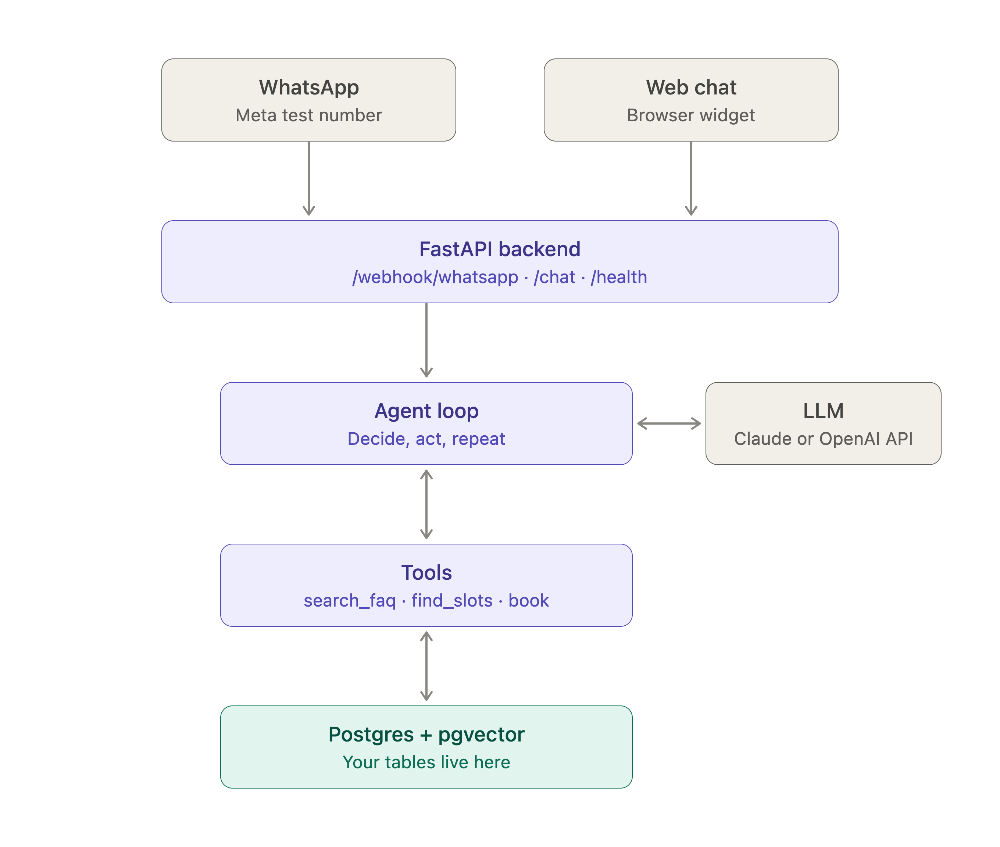

# clinic-agent

Answers patient questions about a made-up Malaysian GP clinic from its FAQ, with citations.

[](https://github.com/WenKhong/clinic-agent/actions/workflows/ci.yml)

## What it does

- **Retrieval over the clinic FAQ.** FAQ answers for "Klinik Contoh" (a fictional clinic) are embedded and stored in Postgres with pgvector.
- **`POST /ask` with citations.** It returns an answer plus the id, source and similarity score of each FAQ chunk the answer came from.
- **Citations are checked in code.** Any id the model cites that wasn't among the chunks it was given is dropped.
- **Fixed "don't know" reply.** If the FAQ doesn't answer the question, the patient gets a fixed "talk to our staff" message, not a guess.
- **Emergency check first.** Phrases like "chest pain" or "sakit dada" get the fixed "call 999" text before any search or LLM call.

## Architecture



*Target design from [SPEC.md](SPEC.md). Built today: FastAPI `POST /ask`, retrieval and Postgres + pgvector, with Gemini as the LLM. WhatsApp, web chat, the agent loop and booking tools are on the [roadmap](#roadmap).*

How `POST /ask` works today:

1. **Emergency check.** If the question contains an emergency phrase, return the fixed emergency text and stop ([app/safety.py](app/safety.py)).
2. **Embed the question** with `gemini-embedding-2` (1536 dimensions), the same model used for the FAQ chunks ([app/embed.py](app/embed.py)).
3. **Retrieve the top 5 chunks** by cosine distance (pgvector `<=>`, HNSW index) ([app/search.py](app/search.py)).
4. **Draft an answer.** `gemini-3.8-flash` answers from those 5 chunks only and returns JSON: `answered`, `answer`, `cited_ids` ([app/ask.py](app/ask.py), [app/prompts.py](app/prompts.py)).
5. **Check and reply.** Code keeps only citations of retrieved chunks, then returns `answered`, `no_answer` or `emergency`.

## Design decisions

- **No similarity-score cutoff → scores don't separate right from wrong on this FAQ.** In testing, a correct answer scored 0.663 while a wrong one scored 0.69. The model's `answered` flag plus the citation check decide relevance instead.
- **Citations checked in code, not trusted → the model can't cite a chunk it never saw.** If no valid citation is left, the reply is the fixed "don't know" text.
- **Emergency check before anything else → missing an emergency is the worst failure.** It doesn't depend on retrieval quality or the LLM.
- **Embedder and LLM are injected → tests never call Gemini.** `search()` and `ask()` take them as arguments, and the API gets them through FastAPI dependencies that tests override with fakes.

## Tech stack

Python 3.13 · FastAPI · Postgres 17 + pgvector · psycopg 3 · Gemini (`google-genai`) · uv · Docker Compose · pytest · ruff · GitHub Actions

## Run it locally

You need Docker, [uv](https://docs.astral.sh/uv/) and a Gemini API key.

```bash
cp .env.example .env                 # then put your key in GEMINI_API_KEY
docker compose up -d                 # Postgres + pgvector; applies db/schema.sql on first start
uv sync                              # install dependencies
uv run python -m app.load_clinic     # load data/clinic.yaml into Postgres
uv run python -m app.embed           # embed FAQ chunks and services (calls Gemini)
uv run fastapi dev app/main.py       # API on http://localhost:8000
```

All settings live in `.env`. See [.env.example](.env.example).

Ask a question:

```bash
curl -s -X POST localhost:8000/ask \
  -H 'content-type: application/json' \
  -d '{"question": "How much do I pay to see the doctor?"}'
```

Example response (from a real run; ids depend on your database):

```json
{
  "status": "answered",
  "answer": "A general consultation is RM40. Medicines, tests, and procedures are charged separately, and the counter will inform you of the total before you pay.",
  "citations": [{"id": 408, "source": "clinic.yaml#fees", "score": 0.735}]
}
```

`status` is one of `answered`, `no_answer` or `emergency`. `citations` is empty unless the status is `answered`.

To see what retrieval returns for a question, without the LLM:

```bash
uv run python -m app.search "what time do you open?"
```

## Tests

With the Compose Postgres running:

```bash
uv run pytest -q
uv run ruff check .
```

The tests cover the data loader, embedding batches, search ranking, every `POST /ask` path (answered, invented citations, not found, emergency, empty question) and the emergency phrases. They use fake embedders and answerers, so they make no API calls. CI runs the same checks against a pgvector service on every push and pull request.

## Safety and data

- **Made-up data only (PDPA).** Klinik Contoh, its doctors and its FAQ are fictional. The loader refuses any file unless it has `clinic.fictional: true`.
- **No medical advice.** The prompt forbids assessing symptoms or suggesting treatment. When the FAQ has no answer, the reply is fixed text, not model output.
- **The emergency check is a stopgap.** It matches about 15 English and Malay phrases. It doesn't yet cover Chinese, SMS spellings ("x boleh"), ambiguous phrases that need context, or an LLM safety classifier. The full design is in [SPEC.md §9](SPEC.md).

## Evaluation

20 questions in [evals/retrieval.yaml](evals/retrieval.yaml) (11 English, 5 Malay, 2 Manglish, 2 Chinese), each listing the FAQ entry that answers it. A hit means that entry is in the top 3 results.

| Metric | Vector-only | Hybrid (vector + keyword, RRF) |
|---|---|---|
| hit@3 | 20/20 (100%) | 18/20 (90%) |

Hybrid didn't help on this set: keyword search counts common words like "my" and "for", so on "I need a sick note for my boss" and "What medicine should I take for my fever?" unrelated chunks pushed the right one out of the top 3. `POST /ask` uses vector search.

Scores can shift by one question between runs (one earlier run gave vector 19/20), so treat small gaps with care. To run it (one Gemini embedding call per question):

```bash
uv run python -m evals.run_retrieval            # hit@3, breakdown by language, disagreements
uv run python -m evals.run_retrieval --show 4   # top 3 of both methods for question 4
```

## Roadmap

From [SPEC.md](SPEC.md). Not built yet:

- [ ] Keyword search that ignores common words, then rerun the hybrid comparison
- [ ] Tool-using agent loop
- [ ] Booking: slots, holds, reschedule, cancel, waitlist
- [ ] Full safety layer: keyword tiers in 3 languages, LLM safety screen, output guard
- [ ] Simplified Chinese support
- [ ] WhatsApp Cloud API channel
- [ ] Web chat widget with OTP
- [ ] Staff dashboard: inbox, takeover, alerts
- [ ] PDPA documents and Malaysian-region deployment

---

Built by Wen Khong, CS (AI) at APU · LinkedIn: TBD
